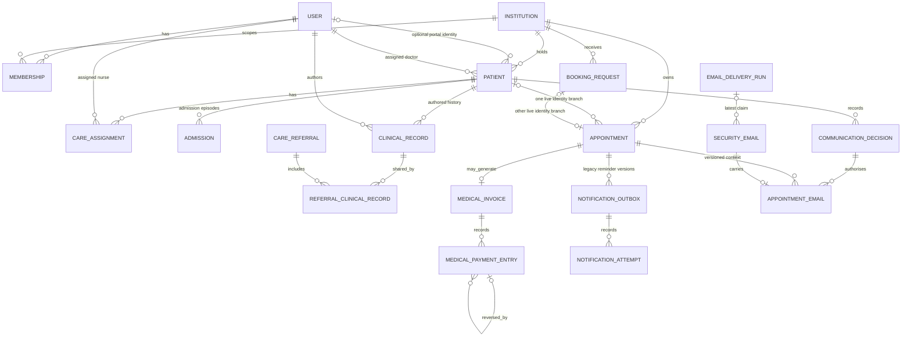

# Ramosolo database, pipelines and exposure review

Hosted evidence comes from read-only Supabase catalog queries. The PostgreSQL tests use a reconstructed catalog and synthetic records on loopback. The deployed Flask and worker connection identities, Supabase API exposed-schema settings and public reverse proxy configuration still need operator confirmation.

## Relationships

The diagram shows the live core and the relevant tables added by the draft chain. `CLINICAL_RECORD` and `COMMUNICATION_DECISION` are from the reconciliation chain, and `SECURITY_EMAIL`, `APPOINTMENT_EMAIL` and `EMAIL_DELIVERY_RUN` are from subsequent drafts. `CARE_ASSIGNMENT` is a patient–nurse association. `REFERRAL_CLINICAL_RECORD` is an existing draft junction for sharing specific clinical records with a referral.

## Findings and decisions

| Area | Evidence | Local implementation or review decision |
|---|---|---|
| Catalog and constraints | Hosted PostgreSQL 17.11 has `ramosolo.schema_versions` 1–6, 30 tables, 32 user triggers and 18 functions. Reconciliation/auth/delivery tables are absent in the observed catalog. The local legacy bootstrap uses `lesonto` and is a different migration path. | Use the observed catalog fingerprint and reconciliation runbook. Do not replay the local bootstrap onto the hosted schema. |
| Appointment identity and duplicate scope | Live appointments require an institution and exactly one patient or booking request. Both identity branches have single-column FKs; PostgreSQL can express equality with the shared institution directly. Local ORM had independent patient/institution links and allows legacy null scope. | 017 adds validated composite FKs for both live identity branches. Scoped Flask reads/mutations reject inconsistent explicit institution links. Legacy local rows with null appointment scope resolve through their scoped patient. No history is rewritten. |
| Doctor, nurse and patient boundaries | Membership uniqueness is `(user_id, institution_id)`. A user can have multiple memberships; a patient's portal identity is unique within its institution. Staff assignment/delegation depends on active role and institution, and a patient resolves to their own record. Live guard routines check appointment assignment; audit history keeps the original actor. | Keep request-scoped Flask authorization plus database guards. A historical doctor's ID is provenance, so don't FK historical records to a current active membership or reassign old appointments when a patient transfers. Cross-institution findings outside the appointment links require a specific drift case and a retention decision before new constraints. |
| Clinical and admission history | Admissions record episodes with date order and at most one open admission per patient. Clinical records have authors and timestamps. Diagnosis entries are authored text; multiple coded diagnoses and shared code definitions would be many-to-many. Current referral junction links individual clinical entries. | Preserve authored clinical text and original episodes. If coded diagnoses become a requirement, design a versioned code catalog and a junction to the originating clinical entry with provenance. No inference or backfill from free text. Count currently admitted patients by open episode and aggregate one-to-many facts separately. |
| Finance | Hosted invoices have a unique appointment link. Payment/reversal entries have invoice/original-entry links and amount, currency and lifecycle guards. Finance isn't a Flask ORM write path. | Keep trigger and audit semantics. Aggregate the payment ledger by invoice before joining diagnoses, visits or admissions. Keep financial writes outside the Flask and mail-worker grants. |
| Contact and consent | `users.email` is the login/contact identity, `patients.email` is the recorded practice contact, `account_verifications` proves account control, and `communication_decisions` record permission per purpose/channel/scope. Legacy in-app consent has its own source; a booking alone grants neither consent nor confirmation. | Keep the distinct facts and require their agreement for appointment mail. Recheck lifecycle, schedule version, lead policy, recipient and current decision before sending. Avoid cross-purpose consent backfill or merging the two queues. |
| Indexes | Operational patient lists and dashboards use institution and doctor. Nursing scope looks up assignments by nurse; the existing unique pair is patient-first. Existing scheduling, outbox and communication-decision indexes cover recurring lookups. | Add `(institution_id, doctor_id)` and `(nurse_id, patient_id)` for those predicates. Add the run lease and job/run diagnostic indexes. These are query-shape justifications. Measure with anonymised plan statistics after an approved staging rollout before adding further indexes. |

## Privileges and identity

- The connected catalog role `postgres` owns the schema and objects and has `BYPASSRLS`. The metadata showed no dedicated `ramosolo` service roles. The tested API principals `anon`, `authenticated`, `service_role` and `authenticator` had no effective `ramosolo` schema access or table SELECT/function EXECUTE. All 30 live tables had RLS disabled. Database-level API access was not observed under those grants. A future schema or ACL change could change exposure, and the gateway's configured schema list remains unverified. See [Supabase Data API controls](https://supabase.com/docs/guides/api/securing-your-api).
- Flask-Login uses a local account, a server-revocable session and a database-backed membership. Browser requests do not present Supabase Auth JWTs. `auth.uid()` cannot supply a Flask identity. The proposed service RLS policies are database role gates, with Flask queries remaining responsible for end-user tenant and patient isolation. Keep `ramosolo` outside exposed API schemas and reject arbitrary tenant GUCs from requests.
- The [runtime-role draft](../verification/runtime_roles.sql) creates `NOLOGIN` grant roles with no ownership, DDL, RLS bypass or finance grants. Portal grants cover app writes, insert-only audit/clinical history, scoped legacy trigger dependencies, owned sequences and named invoker functions. The mail worker gets outbox/run/rate-limit access and limited eligibility projections, including row locks without permission to change either appointment or patient rows. Use separate service logins with only the matching membership and verify effective inheritance on each connection. Keep migrations and privileged provisioning in a separate operator context. Review expired-auth purge and exceptional provisioning commands under separate maintenance privileges before scheduling them.
- The observed `ramosolo` functions are security invokers with `search_path=ramosolo, pg_temp`. No security-definer function directly referencing `ramosolo` was found in the inspected schemas. The prior metadata review documented `public.rls_auto_enable` as an event trigger rather than a data RPC. Reassess future definer functions, role inheritance and default ACLs whenever the catalog changes. Restrict routine EXECUTE and schema CREATE for public/API/service identities. Run the [read-only runtime checks](../supabase/review/security_runtime_readonly.sql) through the protected deployed connection as well as the operator connection.
- The Flask engine now applies validated `SET LOCAL search_path` at transaction start. This handles a rollback on a still-checked-out physical connection and avoids reliance on a pooler's session state. The test covers loopback pooling. Repeat against the chosen hosted pool mode before cutover.

## Pipelines

| Pipeline | Control |
|---|---|
| Transactional email | Existing dedupe keys and per-job states stay in place. PostgreSQL claims with `FOR UPDATE SKIP LOCKED`, checks eligibility again, and records acceptance, suppression or redacted failure codes. Each invocation has a durable run ID, mode, lease, timestamps and aggregate counters. Explicit retry/quota outcomes use bounded backoff; a claim whose outcome cannot be proven after a crash becomes `uncertain` and is never automatically sent again. Review uncertain outcomes through an authorised operator process before generating a fresh intent. Provider acceptance is distinct from mailbox delivery. |
| Legacy portal reminders | The legacy outbox, attempt history, guards and invalidation remain in place. External appointment mail stays in the existing transactional outbox. Prevents legacy state from being mistaken for external provider acceptance. |
| Imports | No demonstrated recurring import or feed was found. For a confirmed feed, agree source identifiers and ownership first. Stage each source batch by durable run ID, validate relationships and field constraints, then load in one transaction with source-version idempotency. Reconcile staged, rejected, inserted, updated and unchanged counts. Advance the source watermark only with the commit; treat absence as deletion only for an approved complete snapshot and prefer audited deactivation when history must survive. |
| Dashboards | Counts are derived on request from authorised records. There is no demonstrated refresh queue or warehouse requirement. A future refresh job needs its own permissions, run ledger and aggregation boundaries. |

Restrict run visibility to authorised operators. Alert on a rising `interrupted`/`uncertain` count, repeatedly exhausted retries, backlog age without recipients, or a provider quota hold that does not clear. Keep timeout policy and metric retention under operator control. Per-run counters count the attempts handled in that invocation, including requeues. They are not historical message delivery totals. Keep test and staging delivery fake and SMS/OIDC disabled until approved.

## Git, secrets and browser exposure

- Git tracked 1,347 files under the previous local PostgreSQL cluster and nine Supabase CLI work files. Those paths were removed from the index while preserving the on-disk copies and existing history. Historical trees also contain `node_modules/`. The source scan flagged a historical URL in `tests/test_connections.py` with fixture-like credential fields. No active credential was confirmed. The scan does not open excluded files; it cannot determine which of them contain credentials or patient data. See `verification/check_release_secrets.py --history` for redacted paths and types. No credential value is included in the report.
- Keep GitHub history restricted pending review by the repository, database and privacy owners. The database owner should review access to the tracked cluster artifacts and the Supabase owner should verify whether any reusable connection credentials were present in linked CLI state. Coordinate rotation of affected role passwords or tokens if the owners establish exposure. Change the corresponding secret-manager version, verify the replacement connection, revoke the prior credential and record the incident. Removing paths from Git tracking does not revoke credentials or remove historical copies.
- Use reviewed Git archives or explicit release manifests, with `.gitattributes` and the CI path/source scan enforced. Avoid packaging the worktree or historic commits as a release. Keep `.env.example` placeholder-only. Production Flask skips dotenv discovery. Use separate injected production/QA/development connection values, Flask signing and MFA encryption keys, a dedicated shared `AUTH_VERIFICATION_KEY`, Gmail OAuth secrets on the mail worker, Twilio credentials on the SMS execution path, and OIDC client secrets on the portal. Plan session revocation or MFA/key-version compatibility as part of any rotation. See the [operator configuration guide](account-security-setup.md).
- Local Flask HTTP tests review rendered HTML, error responses, synthetic CSV downloads, private-path probes and the static inventory. Only public CSS and the session-warning script are allowlisted. Endpoint handlers build purpose-specific output and downloads use server-side record permission checks. Sensitive pages and errors are `no-store`; the browser has CSP, origin/CSRF checks, secure and HTTP-only production cookies, HSTS on HTTPS and allowed hostnames. Application exception logging omits sensitive SQL values and route parameters. The CSV export guards against spreadsheet formulas, including control-prefix and full-width operator cases.
- Check the deployed proxy separately. It should serve only the reviewed asset inventory, reject private routes and backups, trust only the configured proxy scheme hop, and omit URL tokens, queries, bodies and cookies from logs. Browser developer tools remain available. No hosted HTML, public path or upstream proxy probe was performed in this review.

## Staged rollout

1. Obtain an approved backup/PITR point and test restoration. Confirm the live fingerprint, ledger, privileges, RLS and API configuration again. Use count-only mismatch preflight queries for both appointment identities, comparing each appointment's institution with its referenced patient or booking request. Stop for owner-led reconciliation if either count is nonzero.
2. Run the existing hosted reconciliation sequence `010 → 011 → 012 → 013 → 014 → 015 → 016`, then the additive `017`. Compare existing account, membership, episode, audit, booking, finance and pending-outbox counts and constraint/trigger fingerprints. The legacy ledger records 7–9 after 010; track later independent SQL files and approvals separately. See the [reconciliation runbook](live-schema-reconciliation-runbook.md).
3. In staging, apply the role proposal after the migration chain, create service logins through secret custody, and smoke-test all enabled routes and operator jobs under those identities. Check every role's patient and institution scope, current runtime identity via `current_user`, effective privileges, pool reuse after rollback, blocked API roles, worker locking and negative access probes. Validate the production gateway and grants through separate approved changes.
4. Deploy with security/recovery prerequisites from the operator guide. Keep external delivery disabled while confirming queue suppression, fake delivery and run recovery with synthetic records in staging. Approve any live Gmail allowlist separately and confirm the booking notification policy. SMS and SSO each have independent activation approvals.
5. If smoke tests fail, pause the affected workers, leave audit and outbox state intact, and restore the prior compatible application or use the approved restore plan. Never bulk replay uncertain jobs. Recheck any scheduling changes through the collision and reminder guard tests before reopening.

### Local verification

- Default pytest run with synthetic SQLite took the local-only path. It reported 263 passed, 33 skipped and three expected failures. Among the skips, 32 require the real PostgreSQL fixture and one is the existing stale demo prototype. The 32 PostgreSQL cases were run separately on isolated PostgreSQL 17.11 and passed, including concurrency, catalog drift/rollback, Flask role boundaries, worker access and pooled connection reuse.
- The complete production-shaped synthetic chain preserves existing row projections and the reviewed 010 checksum. A historical cross-institution link made 017 roll back atomically, including the run-ledger DDL. The low-privilege worker processed synthetic account and appointment messages with its fake provider and passed the denial probes.
- Focused HTTP checks passed with synthetic data. They include field minimisation, static-path denials, authorised and denied CSV downloads, safe errors, caching and CSRF.
- Headless Chrome at 1280 × 800 and 390 × 844 verified keyboard focus, the offline expiry screen, removal of clinical content and unsaved input from the rendered page, empty persistent browser storage, and access to saved records after fresh MFA. No production browser endpoint was used.

### SQL versions tested

| File | SHA-256 |
|---|---|
| 010 (reviewed, unchanged) | `50067E6FE6898C494D153943242E4F277D9A50BC49695D01B51D69860E054A34` |
| 011 | `6DE3CB9D9E6855C56D0081067C2BF4ADB60B21F6DE22787F3A6B192B7BF5A83A` |
| 012 | `6294E5520DB19AD6969D4C4049582D9F8817C6629096AD6466564909AF135319` |
| 013 | `A33CEBF113621BD8267974531BB8202287C69B7DE566879E8B2A0E98F70406F9` |
| 014 | `FB913275AAD5DDC0007AA4F6AAD96C03D6BCCF9D057A80E51BC12081108E455E` |
| 015 | `56CC602EE3D3285A8310D3D26E925370D9863457594E509033238A885A5072AF` |
| 016 | `C3C6EF006DA8CCB7D31B6C2D0C8E8DF05287CAC081E0CF7D8629B691F46C8D76` |
| 017 | `2E14E02513B3AF8F4640B3484075B92BB3FB2FE0660F03C42EAB3151824EF07A` |
| Runtime-role draft | `5E65C7BF9432EE95A0CF5FE11EC54F618DB219052500C2AE7F6660FD06CC51B8` |
